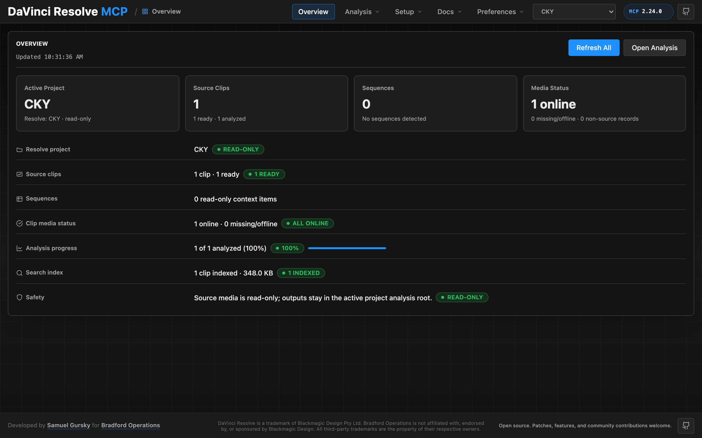

# DaVinci Resolve MCP 伺服器

[English](README.md) | [简体中文](README.zh-CN.md) | 繁體中文

[](https://github.com/samuelgursky/davinci-resolve-mcp/releases)
[](https://www.npmjs.com/package/davinci-resolve-mcp)
[](docs/reference/api-coverage.md)
[-blue.svg)](#伺服器模式)
[-18%20tools-blueviolet.svg)](#伺服器模式)
[](docs/reference/api-coverage.md#test-results)
[](https://www.blackmagicdesign.com/products/davinciresolve)
[](https://www.python.org/downloads/)
[](https://opensource.org/licenses/MIT)

> 本翻譯對應 v5.2.9 版 README。如與英文原版有出入，以[英文原版](README.md)為準。

一個 Model Context Protocol（MCP）伺服器，讓 AI 助理透過官方腳本 API 控制 DaVinci Resolve Studio。它提供完整的 API 覆蓋，並附上有防護機制的工作流程輔助工具，涵蓋剪輯、媒體池整理、算圖輸出設定、審閱標記、調色、Fusion、Fairlight、專案生命週期作業、擴充功能開發，以及不更動原始素材的媒體分析。

[](docs/guides/control-panel.md)

伺服器內建一個本機瀏覽器控制面板，可用來查看 Resolve 狀態、執行不更動原始素材的分析、深入檢視已分析的片段與鏡頭，以及直接在畫面上編輯分析結果。完整導覽請見[控制面板指南](docs/guides/control-panel.md)。

## 快速開始

```bash
npx davinci-resolve-mcp setup
```

連線之前，請先開啟 DaVinci Resolve Studio，把 **Preferences > General > External scripting using** 設為 **Local**。（**免費版**設定這個偏好沒有用，請見下方[免費版](#免費版應用程式內橋接)。）npm 啟動器會在你的使用者應用程式資料目錄下安裝一份受管理的副本，再執行通用的 Python 安裝程式。安裝程式會建立虛擬環境、偵測 Resolve 路徑，並可自動設定 Claude Desktop、Claude Code、Cursor、VS Code、Windsurf、Zed、Continue、Cline、Roo Code、OpenCode、Codex CLI 與 JetBrains 系列 IDE。

從原始碼安裝：

```bash
git clone https://github.com/samuelgursky/davinci-resolve-mcp.git
cd davinci-resolve-mcp
python install.py
```

各平台路徑、各用戶端的設定方式與手動設定，請見[安裝與設定](docs/install.md)。

安裝程式與伺服器會到 GitHub 最新的 release 檢查 MCP 是否有更新。檢查採盡力而為並有頻率限制；伺服器絕不會為了跳出提示而卡住 MCP 啟動。安裝程式可以提示、稍後再提醒、略過某個版本、停用檢查，或對乾淨的 git 工作目錄啟用可選的安全自動更新。

## 免費版（應用程式內橋接）

Blackmagic 把*外部*腳本限定給 Studio 使用：在免費版上，不論偏好設定怎麼設，
`scriptapp("Resolve")` 都會拒絕外部程序。到 Resolve 21.0.x 為止，**Workspace ▸ Scripts**
選單沒有這項限制——從這裡啟動的腳本會拿到執行中的 `resolve` 物件（在免費版 21.0.3.7 上實測）——
因此伺服器可以透過一支在 Resolve *內部*執行的小腳本連到免費版，由它經過一個需要驗證的本機迴路（loopback）
監聽埠把 `resolve` 物件轉出來。**Resolve 21.1 已把 Python 腳本改成 Studio 限定。**
在免費版 21.1 上，Scripts 選單完全不再列出 `.py` 檔（#203 回報於 Fedora 44；同一個資料夾裡的
Lua 腳本仍正常列出）。Console 是否仍能執行 Python 尚未確認，在實測之前，請把這個橋接視為 21.0.x 專用的路徑。

```bash
python scripts/install_resolve_bridge.py
# 重新啟動 Resolve，開啟一個專案，然後：Workspace > Scripts > resolve_bridge
```

安裝程式與 MCP 用戶端預設使用 `~/.config/davinci-resolve-mcp/bridge.json`。
若要把需要驗證的橋接設定檔放在別處，請在執行安裝程式時以及 MCP 用戶端的環境中設定
`DAVINCI_RESOLVE_BRIDGE_CONFIG`，兩邊都會使用該路徑。

監聽埠啟動後，只要外部腳本無法使用，就會**自動**改走橋接，不需要設定任何環境變數。
設定 `DAVINCI_RESOLVE_BRIDGE=1` 則會*強制*使用橋接：它會成為唯一嘗試的傳輸方式，
所以橋接沒有回應時會回報它自己的錯誤，而不會默默退回其他傳輸方式。當你打算就靠橋接這條路時再使用它。

在 **macOS** 上，Resolve 只會在兩個地方找 Python 3：先看 `PYTHON3HOME` 環境變數，
再看 `/usr/local/bin/python3`。Homebrew、pyenv、uv 與 conda 都不會裝在這兩處，
所以腳本會默默地一直不出現在選單裡。python.org 的安裝版可以用，因為它的安裝程式會建立
`/usr/local/bin/python3`——但你不必另外安裝：讓 Resolve 指向你現有的直譯器即可，不需要 `sudo`。

```bash
launchctl setenv PYTHON3HOME "$(python3 -c 'import sys; print(sys.prefix)')"
```

請用 `launchctl setenv`，不要用 `export`——Resolve 是從 Dock 啟動的，看不到你 shell 的環境變數。
設定完請重新啟動 Resolve。安裝時會一併放入一支 Lua 測試腳本，方便你分辨是「沒偵測到 Python」還是資料夾放錯。

有兩個常踩的地方（#182）。該前綴路徑底下必須**同時**有 `lib/libpython3.X.dylib`
與 `bin/python3`，而且名稱必須正好是這個**不含版本號**的名字——Homebrew 的 framework 版本
常常只附 `bin/python3.13`，對 Resolve 來說只算半個 Python，現在安裝程式的事前檢查會明確指出這點，
而不是回報這是可用的前綴路徑。另外，`launchctl setenv` **重新開機後就會失效**；
如果幾週後腳本沒有任何錯誤就不再出現在選單，原因就在這裡。若要永久生效，請把直譯器放到 Resolve
本來就會找的位置（這個做法需要 `sudo`，並請確認 `/usr/local/bin` 在 `PATH` 中沒有排在你平常用的 Python 前面）：

```bash
sudo ln -s "$(command -v python3)" /usr/local/bin/python3
```

已在免費版 21.0.3.7 與 Studio 19.1.3.7（皆為 macOS）上驗證。v2.70.1 新增的 Windows 路徑（issue #106）
發佈時尚未驗證；之後免費版 21.0.1.11（issue #109）與免費版 21.0.3.7（issue #112）的回報顯示，
在 Windows 11 上，橋接從 `%PROGRAMDATA%` 與 `%APPDATA%` **兩處**都能安裝、列出並提供服務，
所以這些路徑現在是已確認而非推測。Linux 也已確認：免費版 20.3.2.9 的一則回報（issue #129，Fedora 43）
顯示橋接安裝到 `~/.local/share/DaVinciResolve/Fusion/Scripts/Utility`，搭配系統 Python 正常列出
（Linux 沒有上述的偵測問題），並且端對端正常運作。現在沒有任何平台是建立在推測上：macOS 為直接驗證，
Windows 與 Linux 依據使用者回報。

注意，橋接在提供服務期間會一直佔用它的連接埠。v2.70.3 之前，Windows 上的橋接可能在 Resolve
關閉後仍未結束，擋住下一次工作階段的監聽埠；如果你用的是較舊的版本且橋接沒有回應，
請檢查是否有殘留的 `fuscript.exe` 還佔著該連接埠。

這是官方文件記載的應用程式內路徑，不是規避授權，但 Blackmagic 有可能關閉它——請把它視為
「在被關閉之前都會支援」的等級。僅限本機迴路、請求以 HMAC 簽章、nonce 只能使用一次。

## 本機控制面板

在儲存庫根目錄啟動單人使用的本機控制面板：

```bash
venv/bin/python -m src.control_panel
```

這個指令會啟動一個只聽本機迴路的伺服器，並在瀏覽器中開啟控制面板，網址會帶著每次啟動各自產生的存取權杖（`http://127.0.0.1:8765/#token=…`）——請使用這個完整網址；沒有權杖的請求會被面板拒絕。若要讓 AI 程式助理代勞，可以這樣說：**「Open the Resolve MCP control panel for this repo.」**（幫這個儲存庫開啟 Resolve MCP 控制面板）。除非你的 Python 環境已經啟用，否則 AI 助理應使用 `venv/bin/python -m src.control_panel`。保存下來的分析工作在每一段成功完成後會自動更新本機搜尋索引；手動的 Build Index 動作是用來從既有報告重建索引。

## 伺服器模式

| 模式 | 進入點 | 工具數 | 適合對象 |
|------|--------|--------|----------|
| 複合（Compound） | `src/server.py` | 37 | 多數 AI 助理的預設模式。相關的 Resolve 操作以 action 參數歸在同一個工具底下，減少上下文用量。 |
| 完整／細粒度（Full / granular） | `src/server.py --full` 或 `src/resolve_mcp_server.py` | 390 | 想要每個 Resolve API 方法各對應一個 MCP 工具的進階使用者。 |

除非你確實需要「一個方法一個工具」的細粒度介面，否則建議使用複合伺服器。

### Advanced 伺服器——超出腳本 API 的部分（選用，Node）

同一個套件還附帶第二個選用的 MCP 伺服器：**`davinci-resolve-advanced-mcp`**（執行檔
`bin/davinci-resolve-advanced-mcp.mjs`）。Python 伺服器是透過官方認可的腳本 API 操作*執行中*的 Resolve，
而 Advanced 伺服器做的是 API **做不到**的事——它讀取與編輯 Resolve 的**檔案**（`.drp` / `.drt` / `.drx`），
並在**不需要開啟 Resolve** 的情況下套用資料庫／XML 層級的變更，所以在雲端*或*本機都能執行。共 18 個工具：
`drp`、`drt`、`drx`（逐片段的調色編解碼器，**另含一套確定性、可離線使用的調色／QC 功能**——同機內與跨機的膚色比對
（v2 膚色線指標）＋B-roll＋中性色塊白平衡比對、比對參考畫面、飽和度／黑位平衡、對比正規化、ASC CDL 匯入、
無損調色轉移＋整季風格製作、掛載具名 LUT、示波器讀值＋意圖標籤、調色驗證、以顯示為準的影格擷取、播出規範 QC）、`offline_ref`、
`conform`（以影格為準的套片／重新連結 QC＋來源脈絡）、`color_trace`（在重新套片後延續調色）、
`fusion`、`audio_plan`、`fairlight`（匯流排路由）、`audio`、`project_read`、`project_db`、`pipeline`
（**以資料庫為準的流程**：把 YAML 專案規格編譯成標準的 SQLite 資料庫，再以關卡、來源紀錄，以及意圖↔實際的偏移偵測來執行各階段）、
`capabilities`、`deliverable`（交付物 QC／規範檢查）、`media`（媒體前端／AE 匯入）、`editorial`（剪輯完整性／變更清單）、
`provenance`（來源紀錄／稽核／單集報告）。它也可以**當作函式庫**使用（可匯入的引擎 API），不只能以伺服器方式啟動。

DRX 調色寫入已**針對 Resolve Studio 實機校準**：調色參數預設使用 Resolve 畫面上面板的單位
（`space: 'ui' | 'drx'`），結構性寫入（窗口、限定器、HDR 區域、HSL 曲線、ColorSlice、模糊／鍵控／動態效果）
都經過面板讀回驗證——各控制項的狀態見 `resolve-advanced/vendor/drx-parameters/CALIBRATION-STATUS.md`。
它也補上一個原本只能在介面上做的功能：**以程式執行「Cleanup Node Graph」**（單一片段用 `drx` `relayout`，
整個專案用 `project_db` `relayout_node_graphs`）——節點排版整理好，調色內容逐位元組保留。

與即時伺服器一起加入設定（兩者都包含在同一次 `npm install` 中）：

```json
{
  "mcpServers": {
    "davinci-resolve": { "command": "<python>", "args": ["<path>/src/server.py"] },
    "davinci-resolve-advanced": { "command": "node", "args": ["<path>/bin/davinci-resolve-advanced-mcp.mjs"] }
  }
}
```

`install.py` 會印出這兩個項目。核心是純 JS／MIT 授權，不需要原生模組；少數功能需要使用者自行安裝的工具
（`audio` 需要 ffmpeg，部分路徑需要 `sharp`／`better-sqlite3`）——呼叫 `capabilities` 工具可查看即時狀態與安裝提示。

與 Python 伺服器不同，這一個有 Node 相依套件。`npx davinci-resolve-mcp setup` 會把它們安裝到受管理的安裝目錄
（在 `resolve-advanced/` 底下執行 `npm install --omit=dev --omit=optional`），裝好之後才註冊執行檔。
如果無法安裝——離線，或沒有 npm——setup 會改為 Advanced 伺服器註冊一個 `npx` 指令，所以它寫入的項目一定能啟動。
若要修復既有安裝而不重跑 setup：`npx davinci-resolve-mcp sync`。

### Bradford Post Assistant——受管理的應用程式（封閉測試中）

維護者也在這個開源基礎上打造了 **Bradford Post Assistant** 桌面應用程式。MCP 伺服器讓 AI
助理有了「手」，Post Assistant 則是圍繞這些工具的工作副駕駛——一個在本機執行的後製 AI 助理，客戶素材永遠不會離開工作站：

- **後製副駕駛**——一個在 DaVinci Resolve 旁邊執行的桌面應用程式，即時觀察工作階段（時間軸、調色與影格，
  不只是 API 呼叫），內建 AI 助理與代理執行環境、本機媒體分析（逐字稿、影格分析、剪輯判讀），以及應用程式內的套片 QC。
- **記憶**——持久保存、加密存放在本機的助理記憶，加上從你流程中解出的事實所學到的跨集經驗
  （整季風格偏移、各攝影機的校正預設值、代表畫面庫、套片路徑對照重用），累積過程由它替你管理，並有經審閱的洞察流程。
- **自成一體的設計**——Post Assistant 會自己把一切接好：用這個 MCP 控制 Resolve、用 Bradford API
  提供延伸服務，以及你選擇的 LLM 供應商。不必手動設定、不必管理額外的用戶端，應用程式（及其內建的 MCP）
  會以有簽章的自動更新保持最新。
- **延伸的專業工具組**——在進行中的專案上做精細調色修正、22 個以上的自適應調色系列、精選風格庫、
  交付規格驗證、剪輯節奏／清理分析、以自然語言下達的調色指示，以及 Fusion 合成製作——透過受管理的 Bradford API 提供。
- **製作流程**——把基本工具組合成完整、實際可用的流程（交片 → 套片 → QC → 交付、整季風格延續、單集報告），
  並具備面對客戶的工作室所期望的防護與核准機制。

目前處於**封閉測試**階段——可到
[bradfordoperations.com/software/post-assistant](https://www.bradfordoperations.com/software/post-assistant) 申請使用。
開源伺服器本身即完整且功能齊全。

## 你可以做什麼

若要為畫面配樂，[Resolve / Live 影片工作流程](docs/guides/film-workflow.md)
提供畫面／cue 基準、變更報告、經驗證的新音軌分軌回傳，以及有證據支持的交接事前檢查。
它會保留原始素材，並明確回報缺少的校準或交付證據。

```text
"List all projects and open the one called 'My Film'"
"Create a timeline called 'Assembly Cut' from all clips in the current bin"
"Build a multicam prep timeline from selected camera angles and preserve source media"
"Detect 2-pops or slate claps and suggest record offsets for sync prep"
"Publish analysis summaries, keywords, people, and slate hints into Resolve clip metadata"
"Probe this timeline for gaps, overlaps, missing media, and source frame ranges"
"Safely import this image sequence, organize it into bins, and normalize clip metadata"
"Build a ProRes 422 HQ render plan, validate the settings, and queue the job"
"Copy review markers from the timeline to the selected clip and export a review report"
"Snapshot this clip's grade, validate a CDL update, and export a temp LUT"
"Create a Fusion TextPlus overlay on the selected clip and verify graph connections"
"Report audio channel mappings, voice isolation availability, and subtitle support"
"Install this MCP-marked DCTL or script, classify refresh/restart needs, then remove it"
```

## 核心功能

| 領域 | 複合伺服器支援的功能 |
|------|----------------------|
| 應用程式與專案控制 | 啟動／重新連線、切換頁面、專案增刪查改、專案資料夾、資料庫、雲端專案包裝、設定、預設集、封存 |
| 媒體池與匯入 | 安全匯入、影像序列、多機位準備時間軸、素材夾整理、中繼資料正規化、中繼資料欄位清單、入出點、註記、重新連結／代理／全解析度防護 |
| 媒體分析 | 不更動原始素材的檔案／片段／素材夾／專案分析、2-pop／打板聲同步事件偵測、預設寫回 Resolve 中繼資料與媒體池標記、保存分析產物、重用既有報告、host_chat_paths 視覺分析（每個片段以 `commit_vision` 完成，適用任何支援視覺的 MCP 用戶端）並可選擇不使用、逐字稿並可選擇不使用 |
| 時間軸剪輯與套片 | 軌道／項目探查、標題文字鍵值掃描／寫入、複製／移動／複製一份輔助工具、波紋插入、範圍操作、空隙／重疊、來源範圍、經檢查的交換格式匯出／匯入 |
| 審閱註記 | 時間軸／項目／片段標記、自訂資料、旗標、片段顏色、複製／移動／同步清理、審閱報告、標記縮圖審閱 |
| 調色 | 節點圖探查、CDL 驗證、調色複製、DRX／LUT 輔助工具、版本、Gallery 靜態畫面、調色群組 |
| Fusion | 時間軸項目合成、安全建立工具、輸入值寫入、連接埠檢查、經驗證的連線、限定範圍的批次寫入 |
| 音訊與 Fairlight | 軌道／項目探查、來源對應、有防護的音訊屬性寫入、人聲分離、自動同步規劃、逐字稿／字幕探查 |
| 算圖與交付 | 格式／編解碼器矩陣探查、算圖設定驗證、佇列工作生命週期檢查、有防護的 Quick Export |
| 擴充功能開發 | Fuse、DCTL、ACES DCTL，以及 Resolve 頁面 Lua／Python 腳本的生命週期輔助工具，並以 MCP 標記安全安裝／移除 |
| 專業指引 | 內附的剪輯、調色、音訊與工作流程指引，以文字形式透過 MCP 提供——有索引、可搜尋，任何用戶端都能讀取，不限本機有這個儲存庫的用戶端 |

### 操作信封（operation envelope）

每個複合工具的回傳都會在內容旁附上一個 `_operation` 區塊，讓 AI 助理讀同一種結構，
而不必每個工具各讀不同的鍵：`status`（`success` / `partial` / `blocked` / `failed`）、
`verification`（其中 `contradiction` 另外區分——Resolve 回報成功，但讀回結果不一致）、
`changes`（語意上的差異）、`warnings`，以及 `execution_id`。

有兩種「沒有」是有意義且刻意的。`verification.status: "unverified"` 代表*沒有回報任何證據*，
不是「檢查過、沒問題」。少了 `changes` 代表這個動作沒有回報差異，不是什麼都沒變——
在那裡放一個空的 `{}`，等於對一個根本沒宣告差異的編輯給出自信但錯誤的答案。

這個信封放在自己的命名空間裡，而不是併入最上層，因為 `status`、`operation`、`warnings`、`result`
與 `changes` 在這裡本來就都是領域用的鍵；攤平的話會改寫背景工作的 `status: "done"` 以及確認關卡的
`status: "confirmation_required"`。`setup(action="set_defaults", params={"result_envelope": "pure" | "legacy"})`
可以改變結構，單次呼叫用 `params={"envelope": ...}`，整個程序用 `RESOLVE_MCP_RESULT_ENVELOPE`。

### AI 助理執行軌跡（「剪輯師為什麼這樣做？」）

多步驟的 AI 操作會跨工具呼叫串成統一的執行軌跡。每條軌跡會彙總工具耗時（`duration_ms`）、呼叫次數、
累計的語意差異（`items_deleted`、`items_added`）以及讀回驗證。AI 助理與剪輯師可以透過 `resolve_control` 檢視工作流程：
`get_execution_trace(execution_id?)`、`list_recent_executions()`，或以 `begin_execution(request="...")` /
`end_execution()` 開啟一段限定範圍的執行。
`export_execution_report(execution_id?, format="markdown"|"json")` 會寫出一份可供審閱的稽核產物，內容是同樣的摘要，
預設寫到 `logs/execution-reports/<execution_id>.md`。改用 `path` 可以寫到任何你想要的位置——例如寫在某次套片旁、
標有日期的 TransferFiles 資料夾裡——並會建立所需的目錄，所以送出前請先確認路徑。
沒有 `overwrite: true` 時，絕不會覆蓋既有檔案。
`inspect_operation(tool?, target_action?, target_params?)` 會在執行前評估事前風險等級（`low`、`medium`、`high`、`critical`）、
破壞性的可能，以及影響範圍（`item`、`track`、`timeline`、`project`、`system`）；
`list_lifecycle_hooks()` 則可檢視目前生效的執行攔截器。

它是依動作名稱做的經驗判斷，不是模擬——它從不碰專案，也不驗證你的參數，所以 `recognised: false`
代表那些等級只是預設值而不是判斷結果，`snapshot_available: null` 代表尚未判定能否還原，而不是不能還原。
內建的每個掛勾都只負責觀察；沒有任何一個會取代工具的結果，所以 `dry_run` 一定會送到真正的處理程式，
也不會替本來沒有預覽功能的動作憑空產生預覽。

一次完全沒有驗證任何東西的執行，報告會寫 **「not established — no checks recorded」**（尚未確立——沒有記錄任何檢查），
而不是「passed」。沒有證據代表問題仍然未解，而稽核文件最不該讓讀者把它讀成一切正常。

軌跡存放在一個 100 筆的記憶體環狀緩衝區，並附加寫入 `server.log` 旁邊的 `logs/execution-traces.jsonl`——
`RESOLVE_MCP_TRACE_FILE` 可以改變它的位置，`RESOLVE_MCP_LOG_FILE` 可以改變 `server.log` 本身的位置
（給一個路徑，或給空值表示不寫檔；離線測試套件會把它指到暫存檔，所以絕不會寫進操作者的 log）。
`list_recent_executions` 會回報該路徑以及是否可寫入，所以不必讀原始碼，就能分辨「log 是空的」與「根本沒有在寫入」。
記錄的內容是工具名稱、動作、時間、狀態、語意差異與驗證結果——沒有參數，也沒有檔案路徑。唯一的自由文字欄位是你傳給
`begin_execution` 的 `request`，所以請像在客戶專案上寫 commit 訊息那樣看待它。

## 已驗證陷阱防護（Verified-Trap Guard）

`src/utils/api_truth.py` 記錄了 Resolve API 中經過實機版本實測、而不是從函式簽名推斷出來的行為——
回傳 `True` 卻什麼也沒做的呼叫、被默默拒絕的設定鍵、根本不存在的方法。這份紀錄以前是**只能主動查詢**的：
它只回應 `resolve_control(action="api_truth")`，平常就是一個沒人會在工作中途去 grep 的檔案。

現在它會在呼叫當下直接告訴呼叫端。對應到有記錄事實的符號的動作，會在結果中附上精簡的 `known_limitation`——
只有符號、實際情況、建議做法，沒有別的，因為在冗長的調色工作階段中，回應的大小是實際的成本，而完整的條目只要再查一次就有。

只有當對應關係明確指名那個符號時，才會附上事實。不會從相似的名稱推論：把不相干的說明釘在一個失敗上，
看起來就像是診斷，而錯誤的診斷比沒有診斷更糟。

**有一種行為會直接拒絕，而不只是警告。** `TimelineItem.CopyGrades` 會整個取代目標的調色——
這是把每個狀態烘焙成 33 點 LUT 並比對位元組實測出來的——它在這樣做的同時回傳 `True`，而且不會建立可以回復的版本。
套用在帶有手工調色的片段上，就是被回報成成功的無法挽回損失。所以會呼叫它的動作會拒絕執行，直到呼叫端傳入
`acknowledge_trap: true`：

```json
{
  "success": false,
  "error": "'timeline_item_color.copy_grades' is refused: its verified behaviour destroys existing work that cannot be recovered afterwards.",
  "known_limitation": [{"symbol": "TimelineItem.CopyGrades", "reality": "...", "recommended": "..."}],
  "retry_with": {"acknowledge_trap": true}
}
```

目的不是禁止這個操作，而是讓呼叫端明確表示自己知道它會做什麼。試跑（dry run）不受此限：預覽不會破壞任何東西。

設定 `RESOLVE_MCP_DISABLE_TRAP_GUARD=1` 可以同時關閉拒絕與主動提示。對過去從破壞性複製收到單純
`{"success": true}` 的呼叫端來說，這是一項行為變更。

用來觸發拒絕的事實必須能夠重新實測，所以有一個實機探測會重新推導每一項事實，並在 Resolve 的行為不再一致時記錄 `drifted`；
如果某個 `destroys_prior_work` 條目沒有對應的探測，測試就會失敗。

## 選用擴充

核心安裝刻意保持精簡：Python、ffmpeg 與 Resolve 腳本 API。有些功能需要更多東西，而且**每一項在缺少時都會老實拒絕，
並給出各自的安裝指令，而不是退而求其次去猜**——捏造的節拍或憑空的音量會產生自信但錯誤的結果，比沒有這個功能更糟。

執行 `python scripts/doctor.py` 可以查看你已經有哪些。

| 擴充 | 啟用的功能 | 授權 |
|---|---|---|
| PATH 中的 **ffmpeg** | 靜音偵測、空白段標記、音量測量、音訊分析。最值得安裝的一項。 | LGPL/GPL——以子程序呼叫，從不內附 |
| `pip install numpy` | 調色預先平衡、參考靜態畫面比對、聲音密度稽核 | BSD |
| `pip install librosa` | 為配合音樂剪輯偵測拍、小節與樂句 | ISC |
| `pip install -U openai-whisper` | 逐字稿，以及所有建立在其上的逐字功能 | MIT |
| `pip install open_clip_torch` | 視覺相似度與 `find_similar` | MIT |
| `pip install transformers` | CLAP 音訊嵌入 | Apache-2.0 |
| `pip install opencv-python` | 額外的影格分析 | Apache-2.0 |

`media_analysis` 的 `capabilities` 動作會詳細回報分析環境，並告訴你每個缺少的部分可以啟用什麼。

**這裡沒有任何東西是內附的。** 模型權重有各自的授權，與載入它們的程式碼分開；商業使用前請先確認。

## 這個工具不做什麼

知道工具的極限在哪裡，和知道它能做什麼一樣有價值，而且在這裡讀到，比在專案進行到一半才發現便宜得多。

| 不支援 | 原因，以及你能得到的替代 |
|---|---|
| **挑出最好的一條** | 一條好不好，大部分取決於表演，而這些都無法從波形或逐字稿量出來。`rank_takes` 排的是*流暢度*——贅詞、重來、劇本涵蓋度——而且每次回應都會這樣說明。真正能用的那一條，常常反而是最不流暢的，因為那份遲疑往往就是表演本身。請用它找出乾淨的保險條，而不是用它決定要用哪一條。 |
| **自動音樂剪輯** | 選用的 `librosa` 支援提供節拍偵測，以及依拍／小節／樂句規劃的剪接點，不是完成的組接。強拍是從第一拍推斷的；有弱起拍時請用 `beat_offset`。語音靜音工具不適合用來找音樂的剪接點。 |
| **評斷剪輯好壞** | 這裡沒有任何東西會對一個剪輯好不好有意見。正因如此，每個破壞性動作都是規劃 → 審閱 → 確認。 |
| **取代剪輯師** | 產出的是第一版組接，就像助理剪輯在做的：匯入、同步、整理、串接、標出問題。它是讓你去剪的起點，不是剪好的成品。預設值刻意**寬鬆**——第一版組接本來就該偏長，因為修短又快又看得見，而找回被丟掉的素材又慢又看不見。 |
| **修改你的原始素材** | 依設計且毫無例外——見下文。 |

凡是分析過但無法驗證的，都會回報為未驗證，絕不會併入「沒問題」。空的結果代表「沒有找到」，絕不代表「沒有東西可找」。

## 原始素材安全

本專案把攝影機原始檔與原始素材視為不可更動。分析工具只會讀取原始檔案，報告只寫到附屬檔、暫存或專案分析目錄；經確認後發佈的中繼資料只會寫進 Resolve 的專案資料庫。除非使用者明確要求，否則伺服器不得修改、轉檔、建立代理檔或產生原始素材的衍生檔。詳細的不更動原始素材工作流程請見[媒體分析指南](docs/guides/media-analysis-guide.md)。

## 安全設計

預設伺服器是由你的 MCP 用戶端啟動的本機 stdio 程序；它不會開啟網路監聽埠，也沒有內建的多使用者驗證介面。兩個需手動啟用的本機 HTTP 介面——控制面板與網路化的 MCP 傳輸——都只綁定本機迴路，每個請求都需要每次啟動各自產生的 bearer 權杖，並檢查 Host／Origin 以防 DNS rebinding 與 CSRF。工具中繼資料包含 MCP 用戶端安全提示，標示唯讀、破壞性、等冪與存取外部資源的操作。兩種伺服器的破壞性寫入都遵守 `destructive.safe_mode` 與安全稽核 log；只有複合伺服器會在變更時間軸前先封存——細粒度寫入只會被拒絕或被記錄，不會被還原。操作界線、確認指引與漏洞回報請見[安全政策](SECURITY.md)。

## 關鍵數據

| 指標 | 數值 |
|------|------|
| MCP 工具 | **37** 複合 / **390** 細粒度（即時伺服器） |
| Advanced（離線）工具 | **18**——.drp/.drt/.drx＋資料庫製作，不需開啟 Resolve |
| Kernel 動作 | 9 個複合工具共 **136** 個有防護的工作流程動作 |
| 已覆蓋的 API 方法 | **361/361**（100%） |
| 已實機測試的方法 | **349/361**（96.7%） |
| 實機測試通過率 | **349/349**（100%） |
| 測試環境 | DaVinci Resolve 19.1.3 Studio＋Resolve 20.3.2 Studio＋Resolve 21.0.2 Studio＋Resolve 21.0.3 與 21.0.4 **免費版**（透過應用程式內橋接） |

逐一方法的狀態請見 [API 覆蓋與測試結果](docs/reference/api-coverage.md)。目前的工作流程支援請見 [Kernel 動作覆蓋](docs/kernels/README.md)。

`analyze_media` 預設會直接執行，把可檢視的報告／產物保存在分析根目錄下，透過 `host_chat_paths` 協定請求宿主對話做視覺分析（analyze 會回傳影格的絕對路徑＋一份 JSON schema；宿主對話把每個影格當成圖片讀取，再呼叫 `media_analysis(action="commit_vision", ...)` 完成），經由設定的本機後端產生逐字稿，並把分析摘要以及以來源時間為準的媒體池片段標記寫回 Resolve 專案。只有在你想關閉這些預設行為時，才傳入 `include_visuals=false`、`include_transcription=false`、`publish_metadata=false`、`timed_markers=no` 或 `dry_run=true`。略過 `commit_vision` 會讓這次執行停在 `pending_host_vision_analysis`——它會被呈現為失敗狀態，而不是默默降級。

## 文件

| 文件 | 用途 |
|------|------|
| [安裝與設定](docs/install.md) | 需求、安裝程式選項、支援的用戶端、伺服器模式、手動設定 |
| [API 覆蓋與測試結果](docs/reference/api-coverage.md) | 關鍵數據、API 覆蓋表、實機測試狀態、完整方法參考 |
| [Kernel 動作覆蓋](docs/kernels/README.md) | 目前有防護的工作流程動作對照 |
| [AI 技能參考](docs/SKILL.md) | 給使用複合伺服器的 AI 助理的操作脈絡 |
| [控制面板指南](docs/guides/control-panel.md) | 本機瀏覽器面板導覽：Overview、Review（素材夾／片段／鏡頭）、Analyze、Setup、Preferences |
| [媒體分析指南](docs/guides/media-analysis-guide.md) | 不更動原始素材的 FFprobe、FFmpeg、Whisper、附屬檔與分析根目錄工作流程 |
| [多機位設定輔助指南](docs/guides/multicam-setup-guide.md) | 堆疊時間軸準備、輔助工具／API 的界線，以及 Resolve 介面上的轉換步驟 |
| [剪輯決策指南](docs/guides/editorial-decision-guide.md) | 專案自訂的剪輯專業指引，用於分析與時間軸決策 |
| [Avid AAF 套片](docs/guides/conforming-an-avid-aaf.md) | 為什麼 Resolve 原生的三條路線在合併過的交片上都會失敗，以及哪一條有危險 |
| [原生 .drt 製作](docs/guides/native-drt-authoring.md) | 離線以範本拼接製作時間軸：剪接、變速、轉場、淡入淡出、標記、複合片段——以及背後實測出的規律 |
| [無頭剪輯迴圈](docs/guides/headless-edit-loop.md) | 從命令列操作 Resolve：哪些交換格式能重新連結並來回轉換，在 GUI 與 -nogui 下實測 |
| [調色決策指南](docs/guides/color-decision-guide.md) | 專案自訂的調色指引，以及 Resolve 調色 API 的界線 |
| [貢獻與專案結構](docs/contributing.md) | 貢獻流程、平台支援、安全注意事項、儲存庫結構 |
| [安全政策](SECURITY.md) | 本機 stdio 信任邊界、工具中繼資料、確認指引、漏洞回報 |
| [發佈流程](docs/process/release-process.md) | 維護者的發佈檢查清單、版本標示位置、驗證、標籤與 release 說明 |
| [更新日誌](CHANGELOG.md) | 歷次 release 說明 |

擴充功能開發參考文件在 [docs/authoring](docs/authoring/)。Resolve 開發者套件筆記在 [docs/notes](docs/notes/) 與 [docs/integrations](docs/integrations/)。提示範例在 [examples](examples/)。

## 系統需求

- macOS、Windows 或 Linux 上的 DaVinci Resolve 18.5 以上版本。**Studio** 直接支援外部腳本。**免費版**不支援——Blackmagic 把外部腳本限定給 Studio——但仍可透過[應用程式內橋接](#免費版應用程式內橋接)連線，它從沒有限制的 **Workspace ▸ Scripts** 選單在 Resolve 內部執行。
- Python 3.10 以上（3.10–3.12 風險最低）。Python 3.13／3.14 在較新的 Resolve 版本上也能用（已在 Studio 20.3.2 上驗證）；較舊的版本在 3.13 以上可能無法連線，這時請改用 3.10–3.12。
- 連不上？`python3 scripts/doctor.py` 會檢查伺服器所用的 Python，並針對每個問題印出確切的修正方式：32 位元或架構不符的 Python、對你的 Resolve 版本來說太新的 Python，或有多個 Python 而 MCP 用戶端啟動了錯的那一個。請見[檢查 Python 環境](docs/install.md#checking-the-python-environment)。
- Resolve 外部腳本設為 **Local**（Studio）。在免費版上這個偏好設定沒有作用——請改用[應用程式內橋接](#免費版應用程式內橋接)。

Resolve 19.1.3 仍是相容性基準。Resolve 20.x 的腳本呼叫是新增性質、有版本防護，並已在 20.3.2 上實機測試。Resolve 21.0 新增的腳本功能（音訊分類、說話者偵測逐字稿、IntelliSearch、場記板分析、動態去模糊、語音生成、工作階段背景工作控制）都放在執行期功能偵測之後，所以在舊版本上不會作用，在 Resolve 21 以上會自動啟用。它們已在 Studio 21.0.2.4 上實機測試——見 [Resolve 21 差異](docs/reference/api-coverage.md#resolve-21-delta-detail)。注意 `AnalyzeForIntellisearch`、`AnalyzeForSlate` 與 `GenerateSpeech` 各自需要另外下載的 AI Extras 套件，而 Resolve 回報缺少套件的方式並不一致（有的回傳 `False`，有的回傳錯誤字串），所以這些動作會以 `success: false` 加上 Resolve 提供的原因回報，而不是用猜的。

## 回報問題與提出功能需求

對你的 AI 助理說「send this as a bug」或「send this as a feature request」（把這個當作 bug／功能需求送出）。它會根據對話起草一則 GitHub issue，包含失敗的呼叫及其錯誤，並附上伺服器版本、Resolve 版本、連線模式與作業系統。本機路徑、你的使用者名稱，以及任何看起來像機密的內容都會被遮蔽。不會替你自動送出：你會拿到一個預先填好的連結，審閱草稿後再自己到 GitHub 送出。你也可以直接[開一則 issue](https://github.com/samuelgursky/davinci-resolve-mcp/issues/new/choose)。

## 開發

```bash
python src/server.py          # 複合伺服器
python src/server.py --full   # 細粒度伺服器
venv/bin/python tests/test_import.py
venv/bin/python scripts/audit_api_parity.py
```

發佈與驗證規則見 [docs/process/release-process.md](docs/process/release-process.md)。在這個儲存庫工作的 AI 助理應從 [AGENTS.md](AGENTS.md) 開始；Claude Code 使用者也可以閱讀 [CLAUDE.md](CLAUDE.md)，它指向同一份正式說明。

## 授權

MIT

## 作者

Samuel Gursky (samgursky@gmail.com)
- GitHub: [github.com/samuelgursky](https://github.com/samuelgursky)

## 致謝

- Blackmagic Design 的 DaVinci Resolve 及其腳本 API
- Model Context Protocol 團隊讓 AI 助理整合成為可能

## 關於本翻譯

由社群貢獻者 [@monarchsofchaos004-gif](https://github.com/monarchsofchaos004-gif) 依英文 README 以臺灣用語翻譯，並隨英文 README 的變更維護。發現翻譯問題歡迎提 issue 或 PR。
